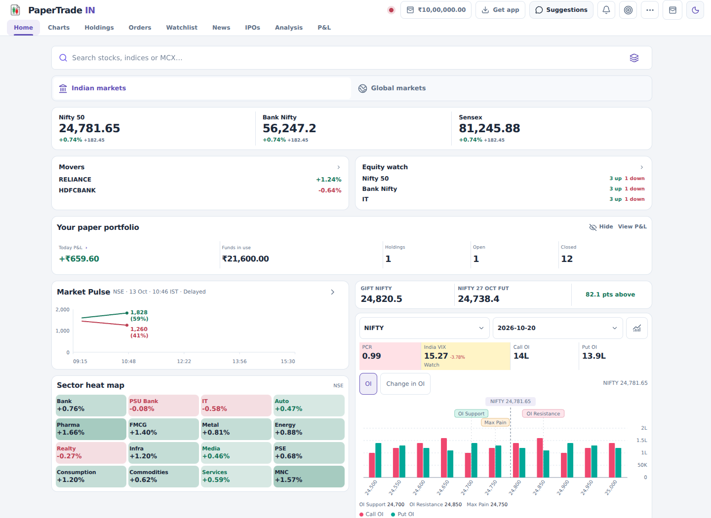
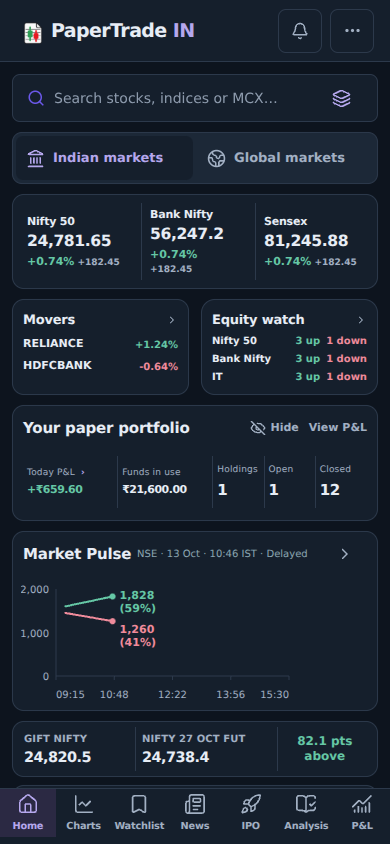

# PaperTrade interface design system

## Scope and audit

The October 2026 redesign applies to the existing React/Vinext application. No dependencies, routes, API handlers, live feeds, authentication flows, trading calculations or persistence formats change. Every label, metric, filter and action remains owned by its existing component.

The audit found overlapping theme declarations across the legacy stylesheets, inconsistent card chrome, small secondary text, and different palettes inside embedded trading tools. `app/terminal-design.css` is the final shared presentation layer. Keep it last in `app/layout.tsx`; extend its tokens and workspace sections rather than adding another competing theme file.

| Workspace | Presentation treatment |
| --- | --- |
| Home, Indian/global markets | Quiet index strip, comparable portfolio values, aligned market cards, compact pulse/sector/OI layouts |
| Charts and order tickets | Matching canvas/chrome, prominent Buy/Sell controls, consistent inputs and readable risk controls |
| Watchlists and scanners | Aligned prices, restrained selected rows, shared search/pickers and scanner surfaces |
| Analysis, peers and top stocks | Shared tabs, consistent summary/filter rows, readable tables and full-screen company review |
| Holdings, orders and P&L | Neutral cards, tabular figures, compact desktop summaries, intact mobile amounts and order labels |
| News and IPOs | Clear headline/value hierarchy, consistent cards, filters, calendar and details |
| Bot, Coach and replay | Unified embedded themes, forms, status cards and controls |
| Notifications, wallet and utility dialogs | Consistent borders, surfaces, focus and typography |
| Sign-in, privacy, terms and account controls | Same palette and type system; device theme outside the terminal |

## Foundations

- System sans stack, retaining Inter when available. No external font request.
- Spacing tokens: 4, 8, 12, 16, 24, 32px. Compact page gutters on phones.
- Radii: 8px controls, 12px cards, 16px dialogs. Full-screen tools retain their geometry.
- Light: slate canvas, white surfaces, violet selection. Dark: navy/slate surfaces, soft violet selection. Existing `light`/`neon` stored preferences remain compatible.
- Text: distinct heading, value, label and supporting styles; tabular financial figures. Mobile values scale to fit without splitting decimals.
- Semantic green/red remain reserved for market direction and trade actions. Heat-map and calendar intensity remain proportional; session shading and indicator series retain their meaning.
- Cards use borders; shadows are reserved for overlays. Loading indicators and meaningful chart interactions remain intact.
- Keyboard focus stays visible, with touch targets expanded on shared mobile controls. Existing safe-area, dialog focus trapping, keyboard navigation and Back behavior remain intact.
- Canvas tokens are mirrored in `lib/chart-palette.ts`; price/indicator series are unchanged. Update both token definitions together when changing canvas colours.

## Verification

The actual dashboard browser matrix covers light/dark at 320, 390, 768 and 1440px, visible Buy/Sell actions, Home search/market-selector separation, intact P&L amounts, major navigation, secondary portfolio views, notifications, wallet, Bot presets and Coach. Browser storage is isolated and checked for unchanged orders. Mock feeds exist only in test browsers; production endpoints and data are untouched.

Additional browser checks cover:

- Home index values, mover/equity filters and chart links.
- Sector heat-map values, FII/DII taps, keyboard inspection and ranges.
- OI/PCR values, risk states, instruments, expiry selection and unavailable data.
- Screener filters, peer/metric pickers and full-screen company analysis in both themes.
- P&L totals from the real calculator, filters, chart/day drills, trade review and Coach handoff; Indian and global ledgers remain unchanged.
- Watchlist mouse/touch/keyboard reordering, persistence, scanner navigation and Back.
- Real signed-out AuthProvider at 320/390/1280px, and legal/account route layout in both device themes. No sign-in, deletion or external account change is performed.

Build and TypeScript checks pass. Focused lint passes for the added files and layout. `MarketChart.tsx` has the same pre-existing 79 errors / 33 warnings on the base and redesign revisions; no new lint findings were introduced there. The build retains its existing bundle-size and route-classification warnings.

### Reproduce

Use Node 22.13+ and the existing dependencies. Supply an externally installed Playwright module with `PLAYWRIGHT_MODULE_PATH`, or use a local Playwright installation. `CHROMIUM_PACKAGE` is optional for packaged Chromium environments.

```sh
npm run build
npx tsc --noEmit
# Start the app, then run against that server:
TEST_BASE_URL=http://127.0.0.1:3000 node --experimental-strip-types tests/browser/interface-design.cjs
TEST_BASE_URL=http://127.0.0.1:3000 node tests/browser/auth-design.cjs
node tests/browser/analysis-inline-list.cjs
node tests/browser/home-market.cjs
node --experimental-strip-types tests/browser/home-pulse.cjs
node tests/browser/home-derivatives.cjs
PNL_APP_URL=http://127.0.0.1:3000 node --experimental-strip-types tests/browser/pnl-dashboard.cjs
TEST_BASE_URL=http://127.0.0.1:3000 node tests/browser/watchlist-workspace.cjs
```

Set `DESIGN_SCREENSHOTS` to an existing output directory to capture the redesign, Analysis and sign-in screens. Screenshots below are of the actual application using isolated test fixtures, not live market snapshots.




